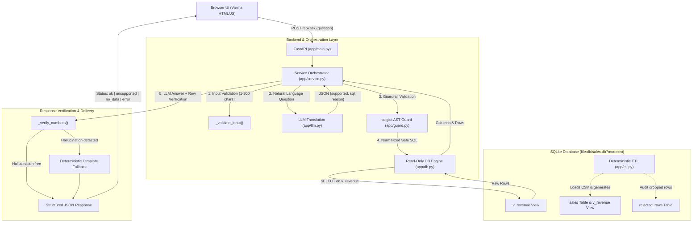

# Mini AI Business Intelligence Assistant

An AI-assisted business intelligence web application that allows users to ask natural-language questions about sales transaction data and receive verifiable, data-backed answers powered by dynamic SQLite queries.

---

## Architecture Overview



### Architecture Explanation
1. **Frontend**: Lightweight, vanilla HTML/JS interface with zero framework dependencies and no build step. All rendering utilizes context-aware HTML escaping to prevent XSS vulnerabilities.
2. **API Layer (`app/main.py`)**: FastAPI application handling HTTP routing, strict Pydantic input validation, status code mapping (`200`, `400`, `422`, `502`, `500`), and structured logging (latency, question, SQL verdict) without exposing API keys or secrets.
3. **Service Layer (`app/service.py`)**: The central pipeline coordinator. Enforces length checks, handles model output parsing, orchestrates SQL execution with a single self-repair retry loop on failure, and validates that generated answer numbers exist in actual database records.
4. **LLM Provider (`app/llm.py`)**: Isolated provider wrapper utilizing Google's official `google-genai` SDK (`gemini-3.8-flash` with `thinking_budget=0` for near-instant responses). Translates natural language into SQLite dialect and outputs strictly typed JSON.
5. **Guardrail Layer (`app/guard.py`)**: AST-based SQL parser using `sqlglot`. Verifies single-statement execution, enforces a strict `SELECT`-only and `v_revenue` table allowlist, and automatically injects `LIMIT 200` to prevent runaway scans.
6. **Data Storage & Execution (`app/db.py`, `app/etl.py`)**: Embedded SQLite database accessed via read-only URI mode (`?mode=ro`). The LLM interacts strictly with the `v_revenue` view, completely isolating raw data and internal tables.

---

## Setup and Execution Instructions

### Option 1: Local Setup (Recommended)

#### Prerequisites
- Python 3.12+ installed
- A Google Gemini API key

#### 1. Clone & Enter Repository
```bash
git clone <your-repo-url>
cd AI_assistant
```

#### 2. Create and Activate Virtual Environment
```bash
python3 -m venv .venv
source .venv/bin/activate
```

#### 3. Install Dependencies
```bash
pip install -r requirements.txt
```

#### 4. Configure Environment
```bash
cp .env.example .env
```
Edit `.env` and configure your API key:
```env
GEMINI_API_KEY=AIzaSy...your-gemini-key...
LLM_MODEL=gemini-3-flash-preview
DB_PATH=db/sales.db
CSV_PATH=data/rgs.csv
```

#### 5. Initialize the Database (ETL)
```bash
python -m app.etl
```
*Note: The FastAPI application also verifies the database on startup and runs ETL automatically if `db/sales.db` is missing.*

#### 6. Start the Web Server
```bash
uvicorn app.main:app --reload
```
Open [http://localhost:8000](http://localhost:8000) in your browser.

---

### Option 2: Docker Setup

Build and run the container:
```bash
docker build -t bi-assistant .
docker run -p 8000:8000 -e GEMINI_API_KEY="your-api-key-here" bi-assistant
```
Access the application at [http://localhost:8000](http://localhost:8000).

---

## How Data is Stored and Queried

### Tables and Views

| Object | Type | Purpose |
|---|---|---|
| `sales` | Table | Stores all 49 valid transactions with strict `CHECK` constraints on numeric columns and `transaction_id` as primary key. |
| `rejected_rows` | Table | Audit log capturing all discarded CSV records, the offending row content, and the specific validation failure message. |
| `v_revenue` | View | **The only database object accessible to the LLM.** Filters for `status = 'Completed'`, exposes pre-computed `net_revenue`, and omits internal state columns. |

### Why `v_revenue` Exists (Security & Simplicity)
1. **Security Isolation**: Acting as a deterministic security boundary, the view ensures the LLM cannot query internal audit logs (`rejected_rows`) or inspect raw unprocessed data.
2. **Simplified Schema for the LLM**: Inside `v_revenue`, every row is already guaranteed to be a completed order. Omitting the `status` column eliminates LLM confusion and prevents errors where the model might forget to filter out cancelled or returned goods.
3. **Pre-calculated Metrics**: `net_revenue` is computed during ETL and exposed as a native view column, ensuring the model never needs to guess discount application logic or formula order.

---

## Data-Handling Decisions

1. **Rejected Rows (Audit Logging)**:
   * `TXN0034`: Discarded because `Quantity = 0`. An order with zero quantity cannot represent a valid revenue-bearing transaction.
   * `TXN0051`: Discarded because `Unit_price` is blank (`NaN`). Revenue cannot be determined without a unit price.
   * Both discarded rows are permanently captured in `rejected_rows` for auditability.
2. **Exclusion of `Returned` Status**:
   * `TXN0033` has `Status = 'Returned'`. It is preserved in the underlying `sales` table for bookkeeping, but filtered out of `v_revenue` so revenue analytics only reflect finalized sales.
3. **Line-Level Discounts**:
   * `Discount_amount` is treated as a total reduction on the line item, not per unit. Blank discount values default to `0.0`.
   * **Formula**: $\text{net\_revenue} = (\text{Quantity} \times \text{Unit\_price}) - \text{Discount\_amount}$.
4. **Standardized ISO Dates**:
   * Raw dates in `DD-MM-YYYY` format are parsed via strict `strptime` and stored as ISO `YYYY-MM-DD` strings.
   * An additional column `order_month` (`YYYY-MM`) is created to allow reliable calendar grouping and chronological sorting in SQLite.

---

## Prevention of Unsupported or Incorrect Answers

### 1. Three Defense Layers for Database Safety
- **Layer 1: AST Query Parsing (`sqlglot`)**: The generated query must parse into a single statement. Semicolons and multiple chained queries (`SELECT 1; DROP TABLE sales`) fail AST validation immediately.
- **Layer 2: Strict Statement & Table Allowlist**:
  - The AST must be an instance of `exp.Select` (plain `SELECT` or CTE with `WITH`). Destructive operations (`DROP`, `DELETE`, `UPDATE`, `INSERT`, `PRAGMA`, `ATTACH`) raise `UnsafeSQL`.
  - Every referenced table must belong to the allowlist: only `v_revenue` and internal CTE aliases are permitted. Direct queries to `sales` or `rejected_rows` are rejected.
  - A mandatory `LIMIT 200` is automatically appended if missing.
- **Layer 3: OS-Level Read-Only SQLite Connection**:
  - Queries are executed using the SQLite URI flag `file:db/sales.db?mode=ro`. Even in the event of an application-layer parsing bypass, the operating system kernel prevents any write, schema alteration, or file manipulation.

### 2. Supported Flag & Scope Guarding
The LLM prompt defines a strict contract:
```json
{"supported": bool, "sql": str, "reason": str}
```
If a user asks about topics out of scope (e.g., weather, forecasting, customer names, profit margins), the LLM returns `{"supported": false, "reason": "..."}`, allowing the application to immediately return HTTP 400 without touching the database.

### 3. Number Verification (Anti-Hallucination)
To ensure the LLM never invents figures:
1. The model generates a one-sentence natural language summary based strictly on the query result table.
2. `_verify_numbers()` extracts all numbers from the LLM's sentence and checks that each value corresponds to an actual number in the database result rows (handling formatting such as commas, decimals, and negative changes).
3. If any hallucinated or unverified number is discovered, the sentence is discarded and replaced with a deterministic template (`_deterministic_answer`) constructed directly from the rows.

---

## How to Run Tests

The test suite contains **65 deterministic tests** verifying the ETL pipeline, AST guardrails, service logic, golden SQL figures, and API endpoints without requiring network calls or paid tokens:

```bash
# Run the complete deterministic test suite
pytest tests/ -v
```

### Optional Live LLM Tests
To test integration against Google's live Gemini API:
```bash
pytest tests/test_service.py -k "live" --live -v
```

### Manual Verification of Ground-Truth Figures
To inspect the hand-verified golden numbers directly from SQLite:
```bash
python scripts/golden.py
```

---

## Supported Example Questions

All five challenge example questions are fully supported:

| Question | SQL Logic Pattern | Expected Result |
|---|---|---|
| **1. Total Revenue** | `SELECT ROUND(SUM(net_revenue), 2) AS total_revenue FROM v_revenue` | ₹1,439,200.00 |
| **2. Highest Revenue Product** | `SELECT product, ROUND(SUM(net_revenue), 2) AS revenue FROM v_revenue GROUP BY product ORDER BY revenue DESC LIMIT 1` | Monitor (₹473,000.00) |
| **3. Monthly Revenue Trend** | `SELECT order_month, ROUND(SUM(net_revenue), 2) AS revenue FROM v_revenue GROUP BY order_month ORDER BY order_month` | 6 months (Jan: ₹210,250 to Jun: ₹211,250) |
| **4. Highest Sales Region** | `SELECT region, ROUND(SUM(net_revenue), 2) AS revenue FROM v_revenue GROUP BY region ORDER BY revenue DESC LIMIT 1` | South (₹411,200.00) |
| **5. Change Between Two Months** | CTE calculating Feb & Mar totals, computing difference and percentage | Feb $\rightarrow$ Mar: -₹10,700.00 (-4.56%) |

---

## Known Limitations

1. **Single View Scope**: The assistant is restricted solely to `v_revenue`. It cannot perform multi-table relational joins across inventory, customer profiles, or cost data.
2. **Stateless (No Conversational Memory)**: Each request is processed independently. Follow-up queries (e.g., *"How about in the North region?"*) do not retain previous context.
3. **Dataset Temporal Window**: The dataset spans only January 2026 through June 2026. Queries requesting dates outside this range return `status: "no_data"`.
4. **Natural Language Ambiguity**: Highly colloquial or ambiguous terminology (e.g., *"top item by orders"* vs *"by revenue"*) may cause the LLM to choose quantity over net revenue unless explicitly clarified by the user.

---

## AI Usage and Debugging Documentation

### AI Tools Used
- **Claude / Gemini / Antigravity Assistant**: Used during development for progressive pair-programming, schema validation, AST guard design, and test suite generation.
- **Google GenAI SDK (`google-genai`)**: Production runtime SDK connecting to `gemini-3.8-flash`.

### Key Problems Encountered & How They Were Debugged
1. **Model Deprecation (404 Error)**:
   - *Problem*: Initial setup targeted `gemini-1.5-flash`, which Google's `v1beta` endpoint reported as discontinued.
   - *Fix*: Upgraded to the modern `google-genai` SDK and configured `gemini-3.8-flash`.
2. **Thinking Latency Spike**:
   - *Problem*: Newer Gemini 3.x models default to generating internal reasoning tokens, adding 8–10 seconds of invisible latency per query.
   - *Fix*: Set `thinking_config=types.ThinkingConfig(thinking_budget=0)` in `app/llm.py`, cutting round-trip response time down to 1–2 seconds.
3. **sqlglot AST Node Types**:
   - *Problem*: `UNION ALL` statements initially produced unexpected error messages during security tests.
   - *Fix*: Debugged using AST node inspection: `sqlglot` classifies `UNION` queries as `exp.Union` rather than `exp.Select`. This confirmed that malicious UNION injection attacks are cleanly blocked at the statement-type validation check before reaching the allowlist.

### What Could Be Improved With Another Day of Work
- **Conversational Memory**: Add a session ID mechanism storing the last generated SQL and parameters to allow contextual drill-downs.
- **Dynamic Visual Charts**: Render interactive SVG bar and line charts in the frontend using Chart.js or vanilla SVG rather than tabular data alone.
- **Semantic Column Synonym Mapping**: Implement a vectorless fuzzy semantic dictionary for product nicknames (e.g. mapping "display" $\rightarrow$ "Monitor").
